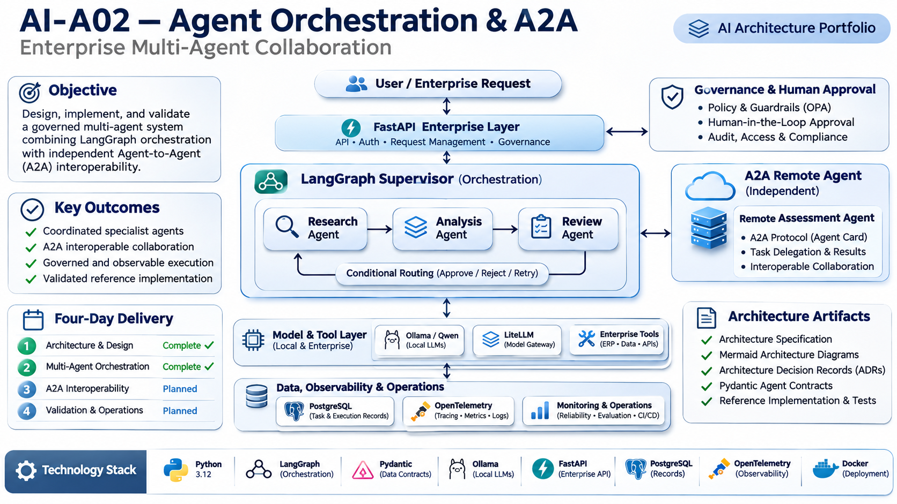
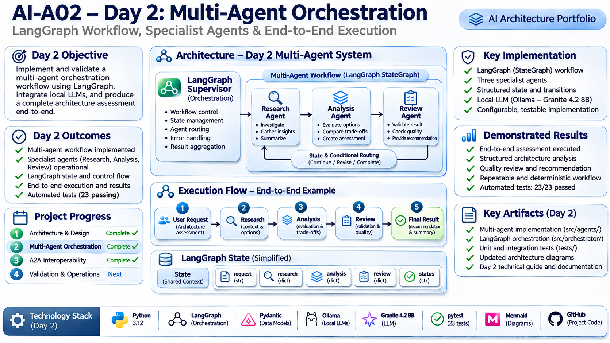
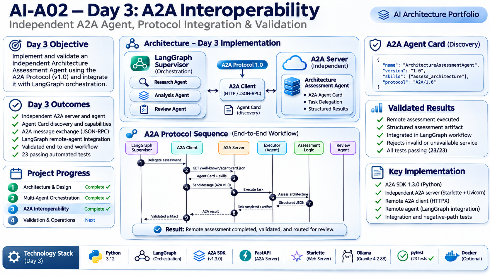
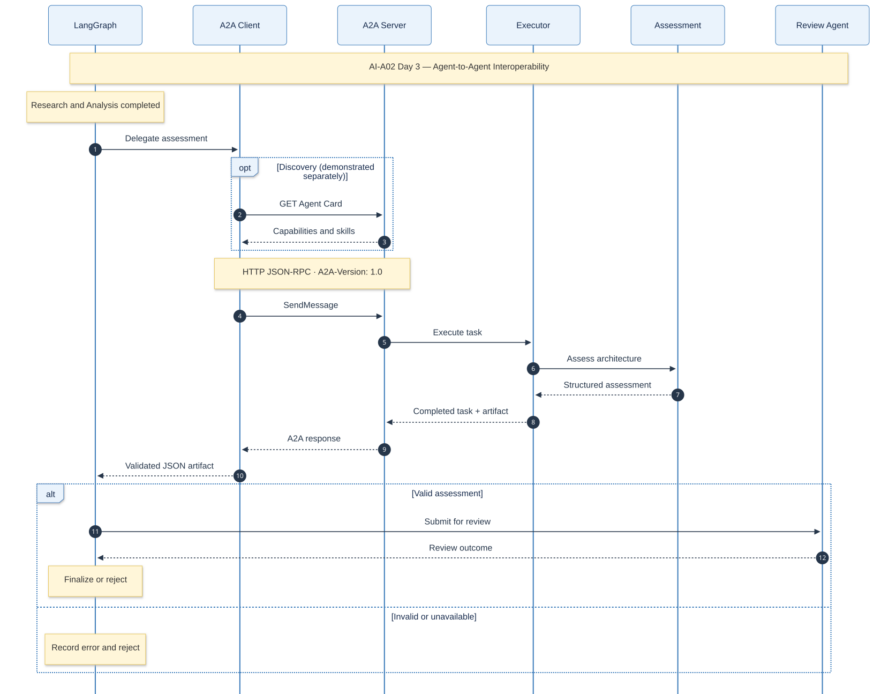
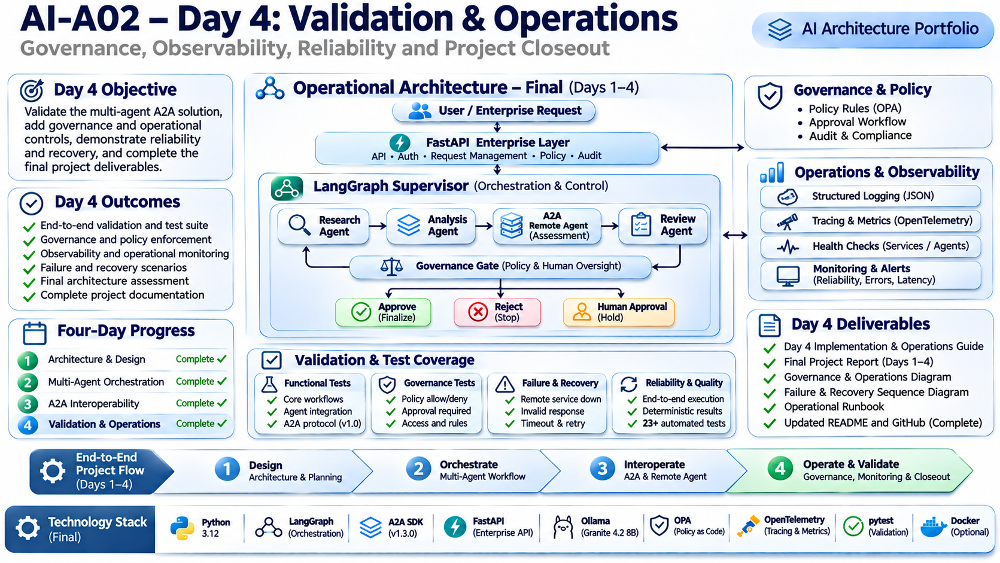

# AI-A02 — Agent Orchestration & A2A

**Enterprise Multi-Agent Collaboration | AI Architecture Portfolio**



A four-day enterprise AI architecture and engineering proof of concept demonstrating governed multi-agent orchestration, independent A2A interoperability, local LLM inference and operational validation.

## Project Status

**Days 1–4: Implementation and validation complete.**

- 39 automated tests passing
- Nine Mermaid architecture diagrams with PNG and SVG renderings
- Six Architecture Decision Records
- Independent A2A agent and client demonstrated
- Governance decisions: PERMIT, DENY and REQUIRE_APPROVAL
- CycloneDX SBOM and dependency security audit
- Structured workflow observability
- A2A failure handling verified
- Consolidated project report completed

This is a validated architecture proof of concept, not a production-ready enterprise platform.

## Four-Day Delivery

| Day | Focus | Status | Documentation |
|---|---|---|---|
| 1 | Architecture & Design | Complete | [Day 1 Guide](docs/AI-A02-1-Architecture-Design-Guide.md) |
| 2 | Multi-Agent Orchestration | Complete | [Day 2 Guide](docs/AI-A02-2-Orchestration-Guide.md) |
| 3 | A2A Interoperability | Complete | [Day 3 Guide](docs/AI-A02-3-A2A-Interoperability-Guide.md) |
| 4 | Governance, Validation & Operations | Complete | [Day 4 Guide](docs/AI-A02-4-Validation-Operations-Guide.md) |

## Final Implemented Architecture



The system combines:

- LangGraph supervisor and conditional workflow routing
- Research, Analysis and Review specialist agents
- Deterministic and LLM-backed execution modes
- Local Granite 4.2 8B inference through Ollama
- Independent A2A Architecture Assessment Agent
- Python governance policy engine
- Structured JSON operational telemetry
- Software supply-chain security evidence

Upstream agent failures route directly to rejection. The governance gate controls finalization after review.

## Day 1 — Architecture & Design

Established the architectural foundation, component responsibilities, state contracts and design decisions.

Deliverables:

- Architecture specification
- System context and container diagrams
- Agent interaction and task lifecycle diagrams
- Pydantic data contracts
- Initial Architecture Decision Records
- Six passing tests at the Day 1 milestone

[Day 1 — Architecture & Design Guide](docs/AI-A02-1-Architecture-Design-Guide.md)

## Day 2 — Multi-Agent Orchestration



Implemented LangGraph-based orchestration with three specialist agents and explicit state transitions.

Features:

- Research, Analysis and Review agent implementations
- Deterministic execution
- Ollama-backed LLM execution
- Granite 4.2 8B
- Structured output validation
- Conditional routing and failure handling
- Sixteen passing tests at the Day 2 milestone



[Day 2 — Orchestration Guide](docs/AI-A02-2-Orchestration-Guide.md)

## Day 3 — A2A Interoperability



Implemented an independently deployed Architecture Assessment Agent using A2A SDK 1.3.0 and A2A Protocol 1.0.

Features:

- Independent Starlette/Uvicorn A2A service
- Agent Card discovery
- JSON-RPC communication
- Structured architecture assessment
- Reusable A2A client
- Optional LangGraph remote-agent integration
- Remote-error handling and fail-closed routing
- Twenty-three passing tests at the Day 3 milestone





[Day 3 — A2A Interoperability Guide](docs/AI-A02-3-A2A-Interoperability-Guide.md)

## Day 4 — Governance, Validation & Operations



Extended the implementation with governance enforcement, software supply-chain security, operational observability and resilience validation.

### Governance

- Deterministic Python policy engine
- PERMIT, DENY and REQUIRE_APPROVAL decisions
- LangGraph governance node and conditional routing
- Approval-required terminal hold state
- Six policy unit tests and three governance integration tests



### Security and Software Supply Chain

| Evidence | Verified result |
|---|---|
| CycloneDX SBOM | Specification 1.6 |
| Software components | 67 |
| Python dependencies audited | 65 |
| Known vulnerabilities reported | 0 |
| AI runtime | Ollama 0.40.13 |
| GPU | NVIDIA RTX 4090 |

The vulnerability result applies to the audited dependencies at the time of assessment, not the security of the complete system.

### Observability and Reliability

- Structured JSON workflow events
- Request correlation identifiers
- Execution duration and final outcome
- Governance decision and error reporting
- Exception logging
- A2A service discovery and remote execution verified
- Remote-service outage tested; finalization correctly blocked

**Latest automated regression result: 39 tests passed.**

[Day 4 — Governance, Validation & Operations Guide](docs/AI-A02-4-Validation-Operations-Guide.md)

## Running the Project

### Activate the environment

```bash
cd ~/development/ai-projects/a-02-agent-orchestration-a2a
source .venv/bin/activate
```

### Deterministic workflow

```bash
python -m scripts.run_workflow --mode deterministic
```

### LLM-backed workflow

```bash
python -m scripts.run_workflow --mode llm
```

### Automated tests

```bash
python -m pytest -q
```

### Start the independent A2A server

In a separate terminal:

```bash
python -m src.a2a_server.server
```

### Execute the A2A client

```bash
python -m scripts.a2a_client
```

See the Operations Runbook for service verification, failure simulation, security commands and troubleshooting.

## Technology Stack

- Python 3.12.3
- LangGraph
- Pydantic
- A2A SDK 1.3.0 / A2A Protocol 1.0
- Starlette and Uvicorn
- Ollama / Granite 4.2 8B
- NVIDIA RTX 4090
- pytest
- CycloneDX and pip-audit
- Mermaid

## Architecture Decisions

| ADR | Decision | Status |
|---|---|---|
| ADR-001 | LangGraph Orchestration | Accepted |
| ADR-002 | Supervisor-Worker Architecture | Accepted |
| ADR-003 | A2A Interoperability | Accepted |
| ADR-004 | PostgreSQL and OpenTelemetry Proposal | Superseded |
| ADR-005 | Implemented State and Observability | Accepted |
| ADR-006 | Governance Policy Enforcement | Accepted |

OPA, PostgreSQL persistence and OpenTelemetry are documented as enterprise evolution options, not implemented components.

## Documentation

**Principal portfolio deliverable:**

[Complete AI-A02 Project Report](docs/AI-A02-Complete-Project-Report.md)

Supporting documentation:

- [Architecture Specification](docs/AI-A02-Architecture-Specification.md)
- [Architecture Decision Review](docs/AI-A02-Architecture-Decision-Review.md)
- [Architecture Decision Records](docs/adr/README.md)
- [Operations Runbook](docs/AI-A02-Operations-Runbook.md)
- [Security Review](security/SECURITY-REVIEW.md)
- [Architecture Diagrams](diagrams/)
- [Infographics](infographics/)

## Limitations and Production Evolution

The proof of concept does not implement:

- Persistent workflow checkpointing
- Durable human approval and resumption
- Production authentication and authorization
- Centralized policy distribution
- OpenTelemetry distributed tracing
- Automatic A2A recovery or high availability
- Dynamic agent planning or parallel multi-agent execution
- Comprehensive model evaluation and benchmarking

The final architecture review describes alternatives, trade-offs and a staged production evolution roadmap.

## License

To be determined.
