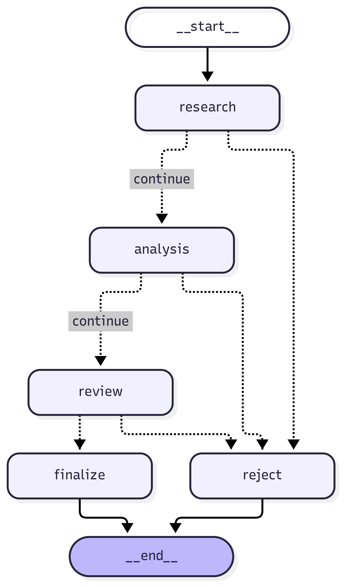
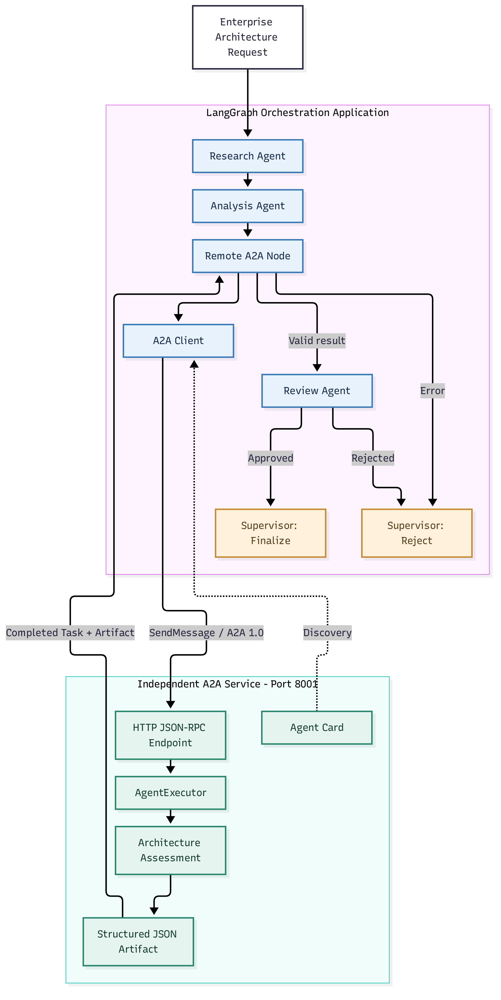
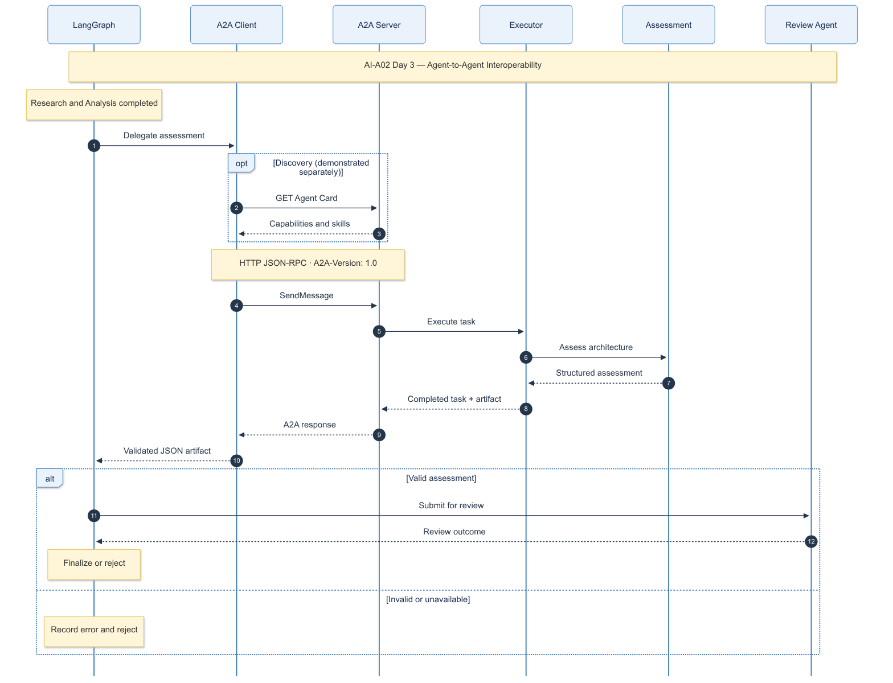

cat > README.md <<'EOF'
# AI-A02 — Agent Orchestration & A2A

**Enterprise Multi-Agent Collaboration**

*Overall target architecture — Days 1–2 complete; Days 3–4 planned.*

Part of the AI Architecture Portfolio.

## Objective

Design, implement, and validate a governed multi-agent
system combining LangGraph orchestration with independent
Agent-to-Agent (A2A) interoperability.

## Project Status

Day 3 of 4 completed.

The local multi-agent orchestration system is implemented
and tested. Remote A2A interoperability remains planned
for Day 3.

## Four-Day Delivery

| Day | Focus | Status |
|---|---|---|
| 1 | Architecture & Design | Complete |
| 2 | Multi-Agent Orchestration | Complete |
| 3 | A2A Interoperability | Complete |
| 4 | Validation & Operations | Planned |

## Implemented Architecture

- LangGraph supervisor with conditional routing
- Shared workflow state
- Research, Analysis, and Review agent roles
- Deterministic execution mode
- LLM-backed Research and Analysis agents
- Ollama inference on NVIDIA RTX 4090
- Pydantic structured output validation
- Failure-aware routing and rejection
- Automated unit and mocked integration tests

## Planned Architecture

- Independent A2A remote assessment agent
- FastAPI enterprise request layer
- PostgreSQL persistent task records
- OpenTelemetry distributed tracing
- Extended governance and human approval controls
- Enterprise model gateway integration

These are design targets, not implemented capabilities.

## Day 1 — Architecture & Design

Deliverables:

- Architecture specification
- Four Mermaid architecture diagrams
- PNG and SVG renderings
- Four Architecture Decision Records
- Pydantic agent contracts
- Six passing automated unit tests

Documentation:

[Day 1 Architecture & Design Guide](docs/AI-A02-1-Architecture-Design-Guide.md)

## Day 2 — Multi-Agent Orchestration

Deliverables:

- Working LangGraph supervisor
- Three specialist agent roles
- Deterministic and LLM execution modes
- Granite 4.2 8B through Ollama
- Structured and semantically validated assessments
- Conditional approval and error routing
- 16 passing automated tests
- Exported implemented LangGraph diagram

### Implemented LangGraph Workflow

Documentation:

[Day 2 Multi-Agent Orchestration Guide](docs/AI-A02-2-Orchestration-Guide.md)

## Day 3 — A2A Interoperability

Implemented an independent Architecture Assessment Agent using
A2A SDK 1.3.0 and A2A Protocol 1.0.

### Deliverables

- Independent A2A server using Starlette and Uvicorn
- Agent Card discovery endpoint
- HTTP JSON-RPC communication
- Structured assessment artifacts
- Remote A2A client
- LangGraph remote-agent integration
- Remote assessment validation
- Fail-closed error handling
- 23 passing automated tests

### Architecture Diagrams

### Technical Documentation

[Day 3 — A2A Interoperability & Implementation Guide](docs/AI-A02-3-A2A-Interoperability-Guide.md)

## Running the Project

Activate the Python environment:

    source .venv/bin/activate

Run deterministic mode:

    python -m scripts.run_workflow --mode deterministic

Run real LLM mode:

    python -m scripts.run_workflow --mode llm

Run automated tests:

    python -m pytest -q

## Technology

- Python 3.12.3
- LangGraph
- Pydantic
- Ollama
- Granite 4.2 8B
- NVIDIA RTX 4090
- HTTPX
- pytest
- Mermaid

## Architecture Documentation

- [Architecture Specification](docs/AI-A02-Architecture-Specification.md)
- [Architecture Decision Records](docs/adr/)
- [Architecture Diagrams](diagrams/)

## Limitations

- Current orchestration follows a predefined workflow.
- Dynamic agent planning is not implemented.
- Parallel multi-agent execution is not implemented.
- Research findings rely on model knowledge, not verified retrieval.
- The final recommendation uses an illustrative selection rule.
- Remote A2A interoperability is implemented and tested.
- Production governance and observability are not yet implemented.

## Next — Day 4

Implement independent agent-to-agent communication using A2A,
including agent discovery, task delegation, structured artifacts,
and protocol-level integration tests.

## License

To be determined.
EOF