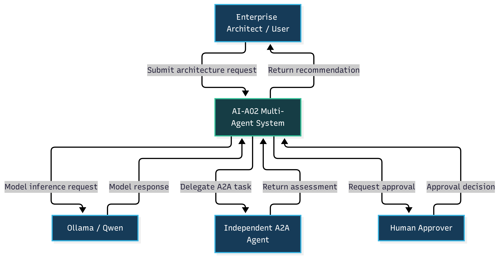
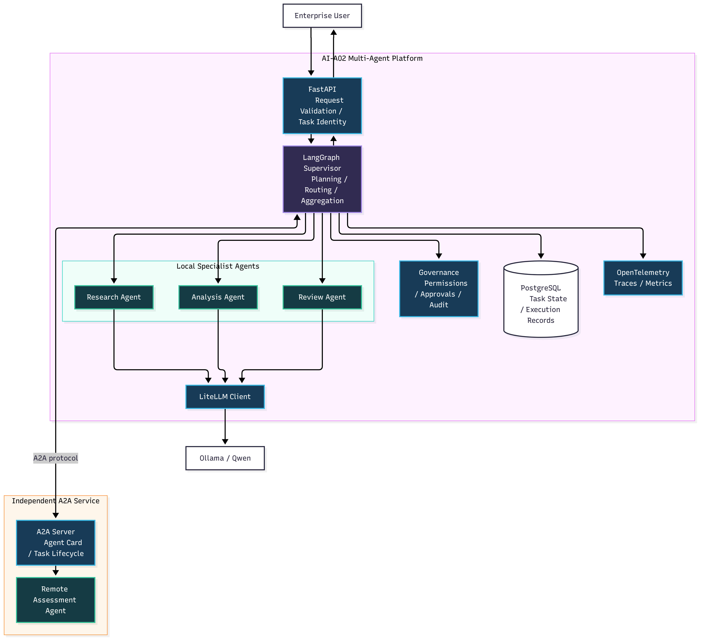
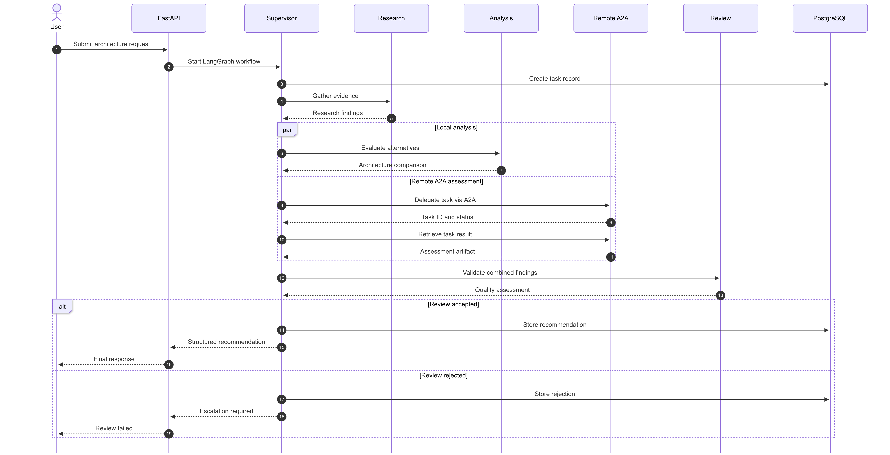
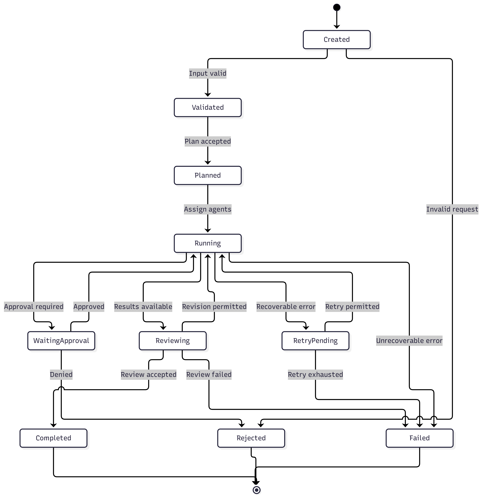

# AI-A02-1 — Architecture & Design Guide

**Project:** AI-A02 — Agent Orchestration & A2A Multi-Agent Collaboration
**Portfolio:** AI Architecture
**Workstream:** Day 1 of 4 — Architecture & Design
**Status:** Design baseline completed
**Environment:** Ubuntu WSL2, Python 3.12.3, pyenv
**Repository:** a-02-agent-orchestration-a2a

---

## 1. Executive Summary

AI-A02 is the second project in the AI Architecture Portfolio.

The project builds on AI-A01 — Enterprise AI Reference
Architecture — by introducing coordinated multi-agent
execution and standards-based agent interoperability.

The architecture combines:

- LangGraph for local workflow orchestration
- A supervisor coordinating three specialist agents
- An independent remote agent communicating through A2A
- Structured Pydantic contracts
- PostgreSQL for persistent execution records
- OpenTelemetry for execution observability
- Governance and human approval boundaries
- LiteLLM and Ollama/Qwen for model inference

Day 1 establishes the architecture and implementation contracts.

Day 1 does not implement the LangGraph workflow, deploy
the remote A2A agent, or demonstrate runtime interoperability.

Those capabilities are scheduled for Days 2 and 3.

---

## 2. Project Objectives and Scope

### 2.1 Primary Objective

Design an enterprise multi-agent architecture supporting
controlled task decomposition, agent collaboration,
delegation, and independent A2A interoperability.

### 2.2 Business Scenario

The proof of concept evaluates an enterprise architecture
decision:

Should an organization deploy local LLM infrastructure,
or adopt managed cloud AI services?

The system is intended to assess:

- Architecture alternatives
- Technical capabilities
- Cost assumptions
- Operational risks
- Governance requirements
- Supporting evidence
- Implementation trade-offs

The final output will be a structured recommendation.

### 2.3 Scope

Included:

- Enterprise request API
- Supervisor-worker orchestration
- Three local specialist agents
- One independent remote A2A agent
- Structured agent contracts
- Application-level task states
- Governance and approval controls
- Execution tracing
- Automated testing

Excluded from the four-day core scope:

- Production-scale deployment
- Kubernetes orchestration
- Complex distributed messaging infrastructure
- Enterprise-wide identity federation
- Production-grade agent registry
- Autonomous production infrastructure changes

---

## 3. Requirements and Acceptance Criteria

### 3.1 Functional Requirements

FR-01: Accept a structured architecture request.

FR-02: Validate the request before execution.

FR-03: Create a unique task identifier.

FR-04: Coordinate three local specialist agents.

FR-05: Support structured handoffs between agents.

FR-06: Delegate an assessment to a remote A2A agent.

FR-07: Validate structured agent results.

FR-08: Aggregate a final architecture recommendation.

FR-09: Support human approval when policy requires it.

FR-10: Record execution outcomes and failures.

### 3.2 Nonfunctional Requirements

NFR-01: Reproducible local execution.

NFR-02: Explicit agent responsibilities.

NFR-03: Observable task execution.

NFR-04: Bounded retries and controlled failures.

NFR-05: Least-privilege delegation.

NFR-06: Independently testable components.

NFR-07: Documented architecture decisions.

NFR-08: Separation of local orchestration from A2A.

### 3.3 Project Exit Criteria

- Three local specialist agents execute successfully.
- A remote agent communicates through a real A2A interface.
- Final outputs conform to validated contracts.
- Invalid and unauthorized requests are rejected.
- Execution records support traceability.
- Failure scenarios are tested.
- Automated tests pass.
- Architecture and implementation are documented.

These are project-wide targets, not claims of Day 1 completion.

---

## 4. Architecture Principles

### AP-01 — Separation of Concerns

Keep request handling, orchestration, specialist agents,
interoperability, persistence, and observability separate.

### AP-02 — Explicit Responsibility

Every agent has a defined purpose, inputs, outputs,
and execution boundary.

### AP-03 — Governed Delegation

The supervisor controls local task routing and determines
when external delegation is permitted.

### AP-04 — Structured Communication

Use typed contracts rather than unrestricted text
for critical agent-to-agent data.

### AP-05 — Interoperability

Use A2A at the independent remote-agent boundary.
Use native LangGraph mechanisms for local agents.

### AP-06 — Observable Execution

Associate execution records and trace context with
workflow and task identifiers.

### AP-07 — Controlled Autonomy

Support defined policy boundaries, approvals,
retries, and escalation.

### AP-08 — Incremental Implementation

Begin with deterministic agent responses.
Introduce actual model inference after orchestration works.

---

## 5. Reference Architecture

The architecture has five primary areas:

1. Enterprise Request Layer
2. Supervisor / Orchestrator
3. Local Specialist Agents
4. Independent Remote A2A Agent
5. Shared Governance, State, and Observability

### 5.1 System Context

Source:

`diagrams/01-system-context.mmd`

Rendered PNG:

The context diagram identifies the enterprise user,
AI-A02 platform, local model service, remote A2A agent,
and human approval boundary.

### 5.2 Container Architecture

Source:

`diagrams/02-container-architecture.mmd`

Rendered PNG:

The container architecture identifies FastAPI, LangGraph,
the three local agents, the A2A service, PostgreSQL,
LiteLLM, Ollama/Qwen, governance, and OpenTelemetry.

### 5.3 System Boundaries

The AI-A02 platform owns local orchestration and
internal task contracts.

The independent A2A service has its own deployment
and protocol interface.

The LLM runtime is accessed as a model service.

These boundaries must remain explicit during implementation.

---

## 6. Agent Roles and Responsibilities

### 6.1 Supervisor

Responsibilities:

- Receive validated requests
- Establish the execution plan
- Route work to specialist agents
- Coordinate task dependencies
- Initiate approved remote delegation
- Aggregate results
- Enforce workflow completion conditions

Implementation target: LangGraph.

### 6.2 Research Agent

Responsibilities:

- Gather evidence
- Record assumptions
- Identify information gaps
- Return structured research findings

### 6.3 Analysis Agent

Responsibilities:

- Compare local and managed AI architectures
- Evaluate trade-offs
- Identify operational risks
- Produce structured architecture assessments

### 6.4 Review Agent

Responsibilities:

- Validate completeness
- Inspect supporting evidence
- Identify inconsistencies
- Check governance considerations
- Recommend acceptance or escalation

### 6.5 Remote A2A Assessment Agent

Responsibilities:

- Publish supported capabilities
- Receive delegated assessment tasks
- Process requests independently
- Expose task status where applicable
- Return structured assessment artifacts

This agent is not a local LangGraph node.
It is accessed across an A2A interoperability boundary.

---

## 7. Orchestration and A2A Communication

### 7.1 Logical Workflow

1. User submits an enterprise architecture request.
2. FastAPI validates the request.
3. Supervisor establishes the execution context.
4. Research Agent gathers evidence.
5. Analysis Agent evaluates architecture alternatives.
6. Supervisor delegates an independent assessment.
7. Remote A2A Agent returns its assessment.
8. Review Agent evaluates combined results.
9. Supervisor aggregates the recommendation.
10. The API returns the final outcome.

Analysis and independent remote assessment are intended
to run concurrently where dependencies permit.

### 7.2 Agent Interaction Diagram

Source:

`diagrams/03-agent-interaction.mmd`

Rendered PNG:

This is a logical interaction diagram.

The actual A2A operations, SDK types, transport behavior,
and task-state mapping will be implemented on Day 3.

### 7.3 LangGraph Versus A2A

LangGraph is responsible for orchestrating the local
agent workflow.

A2A is responsible for protocol-level interoperability
with an independently deployed agent.

A2A is not a replacement for LangGraph.

### 7.4 A2A Versus MCP

A2A concerns agent-to-agent collaboration.

MCP concerns connecting AI applications and agents to
external tools, resources, and services.

Detailed enterprise MCP integration belongs to AI-A04.

---

## 8. State Management and Task Lifecycle

### 8.1 Application Task States

The internal TaskStatus contract defines:

- CREATED
- VALIDATED
- PLANNED
- RUNNING
- WAITING_APPROVAL
- REVIEWING
- RETRY_PENDING
- COMPLETED
- FAILED
- REJECTED

These are application-level states, not official
A2A task states.

### 8.2 Lifecycle Diagram

Source:

`diagrams/04-task-lifecycle.mmd`

Rendered PNG:

### 8.3 State Transition Rules

A request must be validated before planning.

Agents must not execute an unauthorized task.

Approval-dependent work must not proceed before approval.

Retry limits must be bounded.

Terminal outcomes must be persisted.

The state diagram describes the intended design.
Runtime enforcement remains to be implemented.

### 8.4 Persistent State

PostgreSQL is the planned persistence service.

Execution data should include:

- Request ID
- Task ID
- Agent name
- Current status
- Execution timestamps
- Outcome
- Error details
- Trace correlation identifier

Day 1 implements contract definitions only,
not PostgreSQL persistence.

---

## 9. Technology Stack

| Component | Selected Technology |
|---|---|
| Language | Python 3.12.3 |
| Local orchestration | LangGraph |
| API framework | FastAPI |
| Agent interoperability | A2A protocol / Python SDK |
| Data validation | Pydantic 2 |
| Model abstraction | LiteLLM |
| Model runtime | Ollama / Qwen |
| Persistent state | PostgreSQL |
| Observability | OpenTelemetry |
| Deployment | Docker Compose |
| Testing | pytest |
| Diagrams | Mermaid CLI |
| Version control | Git |

Technology selection is based on architectural fit,
project scope, and continuity with AI-A01.

Not every selected technology was installed or
implemented during Day 1.

---

## 10. Architecture Decision Records

Four ADRs were created.

### ADR-001 — LangGraph Orchestration

Decision:

Use LangGraph for explicit, stateful local workflows.

Alternatives:

- CrewAI
- AutoGen
- Custom Python orchestration

Reference:

`docs/adr/ADR-001-orchestration.md`

### ADR-002 — Supervisor-Worker Architecture

Decision:

Use one supervisor coordinating three specialists.

This supports centralized routing, control,
and execution traceability.

Reference:

`docs/adr/ADR-002-agent-topology.md`

### ADR-003 — A2A Interoperability

Decision:

Use A2A for independent agent communication.

Local LangGraph calls remain internal.

Reference:

`docs/adr/ADR-003-a2a.md`

### ADR-004 — State and Observability

Decision:

Use PostgreSQL for persistent execution records
and OpenTelemetry for distributed tracing.

Reference:

`docs/adr/ADR-004-state-observability.md`

---

## 11. Environment and Project Setup

### 11.1 Project Directory

Working directory:

`~/development/ai-projects/a-02-agent-orchestration-a2a`

### 11.2 Python Configuration

Python version: 3.12.3

Version manager: pyenv

Project-specific version:

    pyenv local 3.12.3

Create and activate the environment:

    python -m venv .venv
    source .venv/bin/activate

Verify:

    python --version
    which python

### 11.3 Main Directories

    src/api/
    src/orchestrator/
    src/agents/
    src/a2a/
    src/contracts/
    src/governance/
    src/observability/
    tests/unit/
    tests/integration/
    tests/failure/
    docs/adr/
    diagrams/
    diagrams/rendered/
    infographics/
    scripts/

### 11.4 Dependencies

Install Day 1 dependencies:

    python -m pip install "pydantic>=2,<3" pytest

A dependency snapshot is stored in:

`requirements.txt`

To recreate the recorded environment:

    python -m pip install -r requirements.txt

The dependency snapshot will evolve during Days 2–4.

### 11.5 Mermaid Rendering

Mermaid CLI version observed: 12.2.0

Example:

    mmdc -i diagrams/01-system-context.mmd -o diagrams/rendered/01-system-context.png --size 2560 --scale 2 -b white

Render SVG:

    mmdc -i diagrams/01-system-context.mmd -o diagrams/rendered/01-system-context.svg -b transparent

The CLI uses --size and --scale rather than
the unsupported -w and -H arguments.

---

## 12. Contract Implementation and Validation

### 12.1 Internal Contracts

Implementation:

`src/contracts/models.py`

The module defines:

- TaskStatus
- AgentTask
- AgentResult
- ArchitectureAssessment
- FinalRecommendation

### 12.2 AgentTask

Fields:

- task_id: UUID
- agent_name: string
- objective: string
- context: dictionary
- status: TaskStatus

The default status is CREATED.

### 12.3 AgentResult

Fields:

- task_id
- agent_name
- success
- summary
- evidence
- errors

### 12.4 ArchitectureAssessment

Fields:

- option
- advantages
- disadvantages
- estimated_cost
- operational_risks
- governance_considerations

### 12.5 FinalRecommendation

Fields:

- request_id
- recommended_option
- rationale
- assessments
- evidence
- risks
- approval_required

### 12.6 Automated Tests

Test source:

`tests/unit/test_contracts.py`

Run:

    python -m pytest tests/unit/ -v

Observed Day 1 result:

    6 passed in 0.05s

The passing tests cover:

1. Task defaults
2. JSON serialization round-trip
3. Invalid agent-name rejection
4. Agent result construction
5. Architecture assessment construction
6. Final recommendation construction

These tests confirm basic contract functionality.

They do not demonstrate multi-agent orchestration,
A2A interoperability, task-state enforcement,
or production security.

---

## 13. Results, Limitations, and Day 2 Handover

### 13.1 Completed Deliverables

- Python 3.12.3 environment
- Local Git repository
- Architecture specification
- Four Mermaid source diagrams
- Four rendered PNG diagrams
- Four rendered SVG diagrams
- Four Architecture Decision Records
- Five contract-related Python types
- Six passing unit tests
- Project README

### 13.2 Git Baseline

Branch:

`main`

Day 1 commit:

`75d984d`

Commit message:

AI-A02 Day 1: architecture design and contracts

Files committed: 26

The commit was verified locally.

Remote GitHub publication has not been established.

### 13.3 Known Limitations

- Specialist agents are not yet implemented.
- LangGraph is not yet executing workflows.
- Remote A2A communication has not been demonstrated.
- PostgreSQL persistence is not yet integrated.
- OpenTelemetry traces are not yet emitted.
- Policy enforcement is not yet executable.
- Human approval is represented in design only.
- Agent output quality has not been measured.
- Existing contracts are minimal and may require extension.

### 13.4 Day 2 Implementation Tasks

1. Install LangGraph and required dependencies.
2. Define shared workflow state.
3. Implement a deterministic Research Agent.
4. Implement a deterministic Analysis Agent.
5. Implement a deterministic Review Agent.
6. Create the supervisor graph.
7. Connect the agents through state transitions.
8. Produce a structured recommendation.
9. Add workflow tests and failure handling.
10. Record results and commit the implementation.

### 13.5 Day 2 Exit Criteria

A single validated request must execute through
the local LangGraph workflow and produce a
structured recommendation.

Tests must demonstrate correct routing, state updates,
agent result validation, and controlled failures.

The remote A2A service remains a Day 3 deliverable.

---

## Appendix A — Architecture Artifacts

| Artifact | Location |
|---|---|
| Architecture specification | docs/AI-A02-Architecture-Specification.md |
| System Context | diagrams/01-system-context.mmd |
| Container Architecture | diagrams/02-container-architecture.mmd |
| Agent Interaction | diagrams/03-agent-interaction.mmd |
| Task Lifecycle | diagrams/04-task-lifecycle.mmd |
| Architecture decisions | docs/adr/ |
| Agent contracts | src/contracts/models.py |
| Contract tests | tests/unit/test_contracts.py |
| Dependency snapshot | requirements.txt |
| Rendered diagrams | diagrams/rendered/ |

## Appendix B — Recommended Verification Commands

    python --version
    python -m pytest -q
    git status -sb
    git log -1 --oneline
    ls -lh diagrams/rendered/

## Appendix C — Document Status

This guide describes the completed Day 1 design baseline.

Architecture diagrams and technology descriptions
represent planned system behavior unless specifically
identified as implemented and tested.

Update this guide if subsequent implementation
changes an accepted architecture decision.

**End of AI-A02-1 — Architecture & Design Guide**
