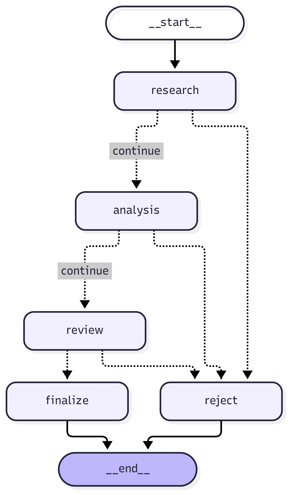

# AI-A02-2 — Multi-Agent Orchestration Implementation Guide

**Project:** AI-A02 — Agent Orchestration & A2A
**Portfolio:** AI Architecture
**Workstream:** Day 2 of 4 — Multi-Agent Orchestration
**Status:** Implementation verified; documentation and commit pending
**Environment:** Ubuntu WSL2 / Python 3.12.3 / RTX 4090

---

## 1. Executive Summary

Day 2 implements and validates local multi-agent orchestration
using LangGraph, Pydantic, and Ollama.

The implementation supports two execution modes:

- Deterministic: reproducible agent behavior.
- LLM: model-generated research and architecture assessments.

Both modes use the same LangGraph workflow topology.

The system coordinates Research, Analysis and Review agents,
routes execution based on errors and quality validation,
and produces an illustrative architecture recommendation.

Observed results:

- Three specialist agent roles implemented.
- Two execution modes demonstrated.
- Local Ollama inference on the RTX 4090 verified.
- Structured LLM output validated through Pydantic.
- Failure-aware workflow routing implemented.
- 16 automated tests passing.
- Implemented workflow graph exported and rendered.

Day 2 does not implement remote A2A interoperability.

---

## 2. Objectives and Scope

### Objectives

1. Implement a stateful LangGraph workflow.
2. Coordinate three local specialist agents.
3. Establish deterministic regression tests.
4. Integrate local LLM inference.
5. Validate structured model outputs.
6. Handle reported agent failures.
7. Export the implemented architecture.
8. Capture reproducible implementation evidence.

### Business Scenario

Compare local LLM deployment with managed cloud AI.

Evaluation dimensions include:

- Infrastructure requirements
- Deployment flexibility
- Operational responsibilities
- Financial assumptions
- Data governance
- Operational risks
- Security and compliance considerations

The present recommendation is illustrative rather than
the result of an independently verified decision model.

---

## 3. Architecture Overview

The implemented workflow is:

START -> Research -> Analysis -> Review -> Finalize -> END

Conditional branches route errors or rejected reviews
to a Reject node.

### Implemented LangGraph Topology

Source:

`diagrams/05-implemented-langgraph.mmd`

The diagram is exported from the compiled LangGraph
implementation rather than drawn manually.

The graph supports two runtime configurations with
the same node names and transition structure.

### Architecture Boundaries

LangGraph manages local workflow execution.

Ollama provides local model inference.

Pydantic validates structured data.

A2A interoperability is reserved for Day 3.

PostgreSQL persistence, distributed tracing, and
production approval services remain future work.

---

## 4. Technology Baseline

| Component | Technology |
|---|---|
| Python | 3.12.3 |
| Orchestration | LangGraph 1.2.19 |
| LangChain Core | 1.7.4 |
| Data contracts | Pydantic 2.14.2 |
| Local inference | Ollama 0.40.13 |
| First integrated model | granite4.2:8b |
| GPU | NVIDIA RTX 4090, 24 GB |
| HTTP client | HTTPX |
| Tests | pytest |
| Architecture rendering | Mermaid CLI 12.2.0 |
| Version control | Git / GitHub |

The full installed Python dependency snapshot is stored
in requirements.txt.

---

## 5. Project Structure

### Workflow Components

`src/orchestrator/state.py`
Defines shared workflow state.

`src/orchestrator/initial_state.py`
Creates isolated initial state with a unique request ID.

`src/orchestrator/supervisor.py`
Builds the LangGraph workflow, selects agent modes,
and implements conditional routing.

### Deterministic Agents

`src/agents/research.py`

`src/agents/analysis.py`

`src/agents/review.py`

### LLM-Backed Agents

`src/agents/research_llm.py`

`src/agents/analysis_llm.py`

The Review Agent remains deterministic in both modes.

### Model Integration

`src/llm/client.py`
Provides Ollama chat and structured generation.

`src/llm/schemas.py`
Defines structured research output.

`src/contracts/models.py`
Defines the shared application-level contracts.

### Scripts

`scripts/run_workflow.py`
Runs deterministic or LLM mode.

`scripts/export_graph.py`
Exports the compiled graph to Mermaid.

---

## 6. Shared Workflow State

The state is represented using Python TypedDict.

Primary fields:

- request_id
- request
- research_findings
- architecture_options
- review_approved
- review_comments
- recommended_option
- recommendation_rationale
- execution_log
- errors

Each workflow starts with a new UUID.

Node functions return partial state updates.

Current workflow execution is sequential.

The execution_log field uses explicit list replacement
based on the prior state rather than a reducer.

This is sufficient for the sequential baseline but
requires reconsideration for concurrent graph branches.

---

## 7. Specialist Agent Implementation

### 7.1 Research Agent

Deterministic mode generates predefined technical findings.

LLM mode calls Ollama and validates a ResearchFindings
response containing:

- findings
- assumptions
- information_gaps

The current workflow propagates the findings list.
Assumptions and information gaps are not yet separately
persisted in the shared state.

### 7.2 Analysis Agent

Deterministic mode creates two fixed assessments.

LLM mode generates separate assessments for:

- Local LLM
- Managed Cloud AI

Both use the ArchitectureAssessment contract.

Required fields include:

- option
- advantages
- disadvantages
- estimated_cost
- operational_risks
- governance_considerations

The agent checks that the returned option matches
the requested alternative.

### 7.3 Review Agent

The Review Agent validates:

- Presence of research findings
- Minimum number of architecture alternatives
- Pydantic assessment schema
- Presence of advantages
- Presence of operational risks

It returns an approval flag and review comments.

Approval indicates basic contract and completeness
checks, not independent verification of factual accuracy.

---

## 8. Orchestration and Conditional Routing

The supervisor supports:

    build_workflow(mode="deterministic")
    build_workflow(mode="llm")

Unsupported modes raise ValueError.

Research and Analysis implementations are selected
when the graph is constructed.

The Review Agent and finalization logic are shared.

### Normal Execution

Research -> Analysis -> Review -> Finalize

### Reported Failure

Research -> Reject

or:

Research -> Analysis -> Reject

### Review Rejection

Research -> Analysis -> Review -> Reject

The error router checks state["errors"].

This detects agent-reported errors, but is not yet
a general exception-handling or retry framework.

### Finalization Rule

The current Finalize node selects the first assessment.

This is a demonstration-only rule.

It does not optimize an objective function or establish
that local deployment is preferable to managed cloud AI.

---

## 9. Ollama Integration

### Local Runtime

Ollama is available in Ubuntu WSL.

API endpoint:

`http://localhost:11434/api/chat`

The initial Granite inference test used:

`granite4.2:8b`

The model was observed running 100% on the GPU.

### Inference Configuration

The client uses:

- Non-streaming responses
- Low-temperature generation
- Thinking disabled
- Output-length limits
- Request timeouts
- Nonempty-response validation
- Truncation detection

### Structured Generation

The Ollama API receives a JSON schema generated
from a Pydantic model.

The returned content is validated with:

    schema.model_validate_json(content)

Semantic checks are also required.

An earlier experiment returned a structurally valid
assessment with option="N/A".

The contract was subsequently restricted to the
supported options, and invalid "N/A" was rejected.

This demonstrates that syntactic schema correctness
alone is insufficient for reliable agent execution.

---

## 10. Environment Setup

Enter the repository:

    cd ~/development/ai-projects/a-02-agent-orchestration-a2a

Activate Python:

    source .venv/bin/activate

Verify:

    python --version

Expected Python version:

    Python 3.12.3

For a fresh virtual environment, recreate it using
the repository's .python-version and requirements.txt.

Install recorded dependencies:

    python -m pip install -r requirements.txt

Check Ollama:

    ollama --version
    ollama list
    ollama ps

Verify GPU visibility:

    nvidia-smi

Confirm that the intended model is installed before
running the LLM execution mode.

---

## 11. Reproducing Workflow Execution

### Deterministic Mode

Run:

    python -m scripts.run_workflow --mode deterministic

Observed result:

- Four research findings
- Two architecture alternatives
- Review approved
- Illustrative Local LLM recommendation
- No execution errors

### LLM Mode

Run:

    python -m scripts.run_workflow --mode llm

Observed result from successful execution:

- Three model-generated research findings
- Two validated architecture alternatives
- Review approved
- Illustrative Local LLM recommendation
- No execution errors

The actual model-generated findings may vary.

### Custom Request

Example:

    python -m scripts.run_workflow --mode llm --request "Evaluate local LLM versus managed cloud AI"

The present deterministic and LLM agents are specifically
designed around the local-versus-cloud comparison.

Arbitrary request handling is not yet general-purpose.

---

## 12. Testing and Validation

### Execute Full Test Suite

    python -m pytest -q

Observed result:

    16 passed in 0.16s

### Test Categories

Contract tests verify model construction,
basic validation, and serialization.

Research tests verify output generation,
logging, and input immutability.

Workflow tests verify normal execution,
execution order, rejection, request validation,
and failure-aware routing.

Mocked LLM integration tests verify both successful
LLM-mode orchestration and failure routing.

The mocked integration tests do not invoke Ollama.

### Live Model Validation

Separate manual tests demonstrated:

- Ollama API connectivity
- GPU-backed inference
- Complete natural-language response
- Structured Pydantic assessment generation
- Semantic option validation
- LLM Research execution
- LLM Analysis execution
- Full LangGraph execution in LLM mode

These live checks are not included in the 16
automated pytest tests.

---

## 13. Exporting the Implemented Graph

Generate the Mermaid source:

    python -m scripts.export_graph

Expected output:

`diagrams/05-implemented-langgraph.mmd`

Render PNG:

    mmdc -i diagrams/05-implemented-langgraph.mmd -o diagrams/rendered/05-implemented-langgraph.png --size 2560 --scale 2 -b white

Render SVG:

    mmdc -i diagrams/05-implemented-langgraph.mmd -o diagrams/rendered/05-implemented-langgraph.svg -b transparent

The rendered PNG and SVG were generated and
visually reviewed during Day 2.

---

## 14. Limitations and Architecture Risks

### Deterministic Planning

The graph follows a predefined sequence.

Dynamic planning and supervisor-directed task decomposition
have not been implemented.

### No Parallel Agent Execution

The current workflow is sequential.

Parallel graph branches would require safe state
merging, reducers, and additional concurrency tests.

### Limited Decision Intelligence

The Finalize node selects the first alternative.

The architecture recommendation is illustrative.

### Limited Evidence Grounding

The Research LLM Agent relies on model knowledge.

There is no live source retrieval, citation verification,
or enterprise RAG integration.

### Limited Operational Persistence

Execution logs are stored in workflow state.

Durable database-backed execution records are not
yet implemented.

### Governance

Human approval gates, identity enforcement, and
policy-as-code are planned but not operational.

### Error Recovery

Reported agent errors are routed to rejection.

Automatic retries, checkpoint recovery, cancellation,
and comprehensive exception handling are not complete.

### A2A

There is no independently deployed remote agent yet.

A2A implementation belongs to Day 3.

---

## 15. Day 2 Exit Criteria

| Criterion | Result |
|---|---|
| LangGraph workflow executes | Passed |
| Three specialist roles operate | Passed |
| Deterministic mode | Passed |
| LLM mode | Passed |
| Structured model output | Passed |
| Conditional review routing | Passed |
| Reported-error routing | Passed |
| Automated tests | 16 passed |
| Implemented graph exported | Passed |
| GitHub publication | Pending |

Day 2 establishes a working local orchestration
proof of concept.

It does not establish production readiness.

---

## 16. Day 3 Handover — A2A Interoperability

The next project day will introduce an independent
remote assessment agent.

Planned deliverables:

1. Verify the selected A2A SDK and protocol version.
2. Implement an independent A2A server.
3. Publish an Agent Card.
4. Implement the supervisor-side A2A client adapter.
5. Map internal and A2A task representations.
6. Exchange assessment tasks and artifacts.
7. Test successful and failed remote delegation.
8. Extend the implemented architecture diagram.
9. Produce the Day 3 technical guide.

The existing deterministic workflow will remain
available for regression testing.

---

## Appendix A — Source References

- src/orchestrator/state.py
- src/orchestrator/initial_state.py
- src/orchestrator/supervisor.py
- src/agents/research.py
- src/agents/analysis.py
- src/agents/review.py
- src/agents/research_llm.py
- src/agents/analysis_llm.py
- src/llm/client.py
- src/llm/schemas.py
- src/contracts/models.py
- scripts/run_workflow.py
- scripts/export_graph.py
- tests/unit/
- tests/integration/

## Appendix B — Verification Commands

    python -m pytest -q
    python -m scripts.run_workflow --mode deterministic
    python -m scripts.run_workflow --mode llm
    python -m scripts.export_graph
    git status -sb
    git diff --check

## Appendix C — Document Status

This document describes the Day 2 implementation
and observed results.

Future changes to the workflow must be reflected
in the appropriate project documentation.

**End of AI-A02-2 — Multi-Agent Orchestration Guide**
