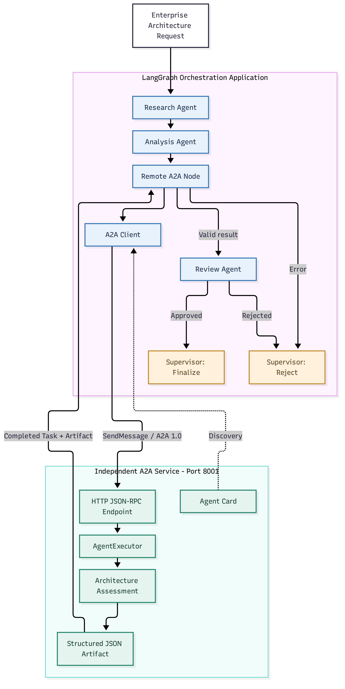
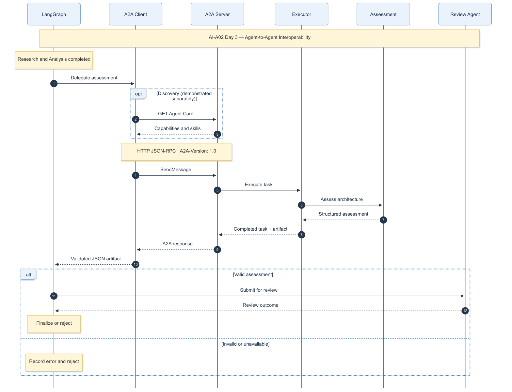

# AI-A02-3 — A2A Interoperability & Implementation Guide

## 1. Executive Overview

Day 3 extends the AI-A02 LangGraph multi-agent application
with an independently deployed Architecture Assessment Agent
communicating through A2A Protocol 1.0.

The project demonstrates standards-based task delegation,
remote agent execution, structured artifacts, validation,
and supervisor-controlled completion or rejection.

The remote agent uses deterministic assessment logic.
The purpose is to demonstrate interoperability rather than
additional LLM intelligence.

## 2. Objectives

- Deploy an agent independently of the LangGraph application.
- Publish an A2A Agent Card for capability discovery.
- Communicate using HTTP JSON-RPC and A2A Protocol 1.0.
- Delegate an architecture assessment task.
- Return a structured assessment artifact.
- Integrate the remote agent into LangGraph.
- Validate results and reject unsuccessful operations.
- Preserve existing deterministic and LLM workflow modes.

## 3. System Architecture

The system consists of two independently running components.

### 3.1 LangGraph Application

Responsible for orchestration, research, analysis, delegation,
review, and the final supervisor decision.

Execution flow:

Research → Analysis → Remote A2A → Review → Finalize/Reject

The remote A2A stage is optional. The original Day 2
execution modes remain supported.

### 3.2 Independent A2A Agent Service

An HTTP service running on 127.0.0.1:8001.

Responsibilities:

- Publish an Agent Card.
- Accept A2A Protocol 1.0 requests.
- Manage the task execution lifecycle.
- Execute the architecture assessment.
- Return a structured result artifact.

The service is implemented using the A2A Python SDK,
Starlette, and Uvicorn.

## 4. Component Responsibilities

| Component | Implementation | Responsibility |
|---|---|---|
| Supervisor | src/orchestrator/supervisor.py | Workflow routing |
| State | src/orchestrator/state.py | Shared workflow data |
| Research Agent | src/agents/research.py | Research findings |
| Analysis Agent | src/agents/analysis.py | Architecture alternatives |
| A2A Node | src/agents/remote_a2a.py | Remote task delegation |
| A2A Client | scripts/a2a_client.py | Protocol communication |
| A2A Server | src/a2a_server/server.py | HTTP endpoints and Agent Card |
| AgentExecutor | src/a2a_server/executor.py | Remote task execution |
| Assessment | src/a2a_server/assessment.py | Assessment logic |
| Review Agent | src/agents/review.py | Assessment validation |
| Integration Tests | tests/integration/ | Communication and failure tests |

## 5. End-to-End Execution Process

### Step 1 — Enterprise Request

The workflow receives a request to evaluate an enterprise
multi-agent architecture.

### Step 2 — Research

The Research Agent produces findings and stores them in the
shared workflow state.

### Step 3 — Analysis

The Analysis Agent evaluates architecture alternatives.

### Step 4 — Remote Delegation

LangGraph calls the remote A2A node.

The node invokes the A2A client, which submits a JSON-RPC
SendMessage request to the independent assessment service.

The request includes the required HTTP header:

    A2A-Version: 1.0

### Step 5 — Remote Execution

The A2A server receives the request.

The AgentExecutor establishes the task context, starts the
task, invokes assessment logic, and publishes an artifact.

### Step 6 — Artifact Return

The remote service returns an A2A task containing a JSON
assessment artifact.

The artifact includes:

- Request
- Assessment
- Strengths
- Risks
- Recommendation

### Step 7 — Validation

The A2A client checks successful task completion and extracts
the result artifact.

The LangGraph A2A node validates the immediate response.

The Review Agent validates architecture options and remote
assessment content when the workflow reaches that stage.

### Step 8 — Supervisor Decision

If validation succeeds, the workflow can finalize.

If an error is recorded, the supervisor routes to rejection.

The current final-option selection remains an illustrative
rule rather than an evidence-weighted ranking.

## 6. A2A Protocol Implementation

Protocol: A2A 1.0

Transport: HTTP

RPC format: JSON-RPC

Agent service: http://127.0.0.1:8001/

Agent Card endpoint:

    /.well-known/agent-card.json

The Agent Card advertises the architecture assessment skill,
supported interface, protocol version, and input/output modes.

A successful transaction returns a task with:

    TASK_STATE_COMPLETED

The task contains an artifact named:

    architecture-assessment

## 7. Running the System

Activate the project environment:

    source .venv/bin/activate

Start the independent A2A server in Terminal 1:

    python -m src.a2a_server.server

Run the standalone client in Terminal 2:

    python -m scripts.a2a_client

Run automated tests:

    python -m pytest -q

The server and LangGraph client execute in separate processes.

## 8. Validation and Observed Results

Verified during Day 3:

- HTTP Agent Card discovery returned 200 OK.
- A2A Protocol 1.0 request was accepted.
- Remote task reached TASK_STATE_COMPLETED.
- Structured assessment artifact was returned.
- End-to-end LangGraph execution completed.
- Remote assessment validation succeeded.
- Existing Day 2 regression tests remained passing.

The final automated test count must be confirmed before
project closeout.

## 9. Failure Handling

The remote A2A node records errors and prevents the supervisor
from finalizing when immediate remote validation fails.

Integration tests cover:

- Successful A2A response
- Empty client request
- Protocol error
- Incomplete remote task
- Missing assessment artifact
- Invalid remote assessment
- Unavailable remote agent

Failure-path behavior is tested with mocks.

## 10. Architecture Decisions

### Independent Deployment

The assessment agent runs independently, establishing a
real communication boundary.

### Standards-Based Interoperability

A2A is used rather than a custom agent communication protocol.

### Centralized Orchestration

LangGraph retains control of workflow routing and decisions.

### Fail-Closed Delegation

A failed remote call does not silently produce an approved
recommendation.

### Deterministic Assessment

The remote agent initially uses deterministic logic so
protocol interoperability can be validated independently
of model quality and inference availability.

## 11. Limitations

- The A2A service currently runs locally.
- The remote assessment logic is deterministic.
- No production authentication or authorization is implemented.
- The task store is in memory.
- No distributed tracing has been implemented yet.
- Human approval remains a planned governance capability.
- The final recommendation is illustrative.
- Remote agent discovery is demonstrated through the Agent
  Card endpoint; dynamic capability-based agent selection
  is not implemented.

## 12. Day 4 Handover

Day 4 focuses on validation and operations:

- Operational readiness and observability
- Governance and policy enforcement
- Reliability and failure recovery
- Persistence and auditability
- Final architecture validation
- Consolidated project documentation

## 13. Project Outcome

Day 3 demonstrates that an existing LangGraph application
can delegate work to an independently running A2A agent,
receive a structured artifact, and incorporate the result
into a governed workflow decision path.

This establishes a practical foundation for extending
AI-A02 to independently deployed enterprise AI agents.

---

## 14. Implemented Architecture Diagrams

### 14.1 A2A Implemented Architecture

This diagram illustrates the LangGraph orchestration application,
the independent A2A service, and the communication boundary.

[View scalable SVG](../diagrams/rendered/06-a2a-implemented-architecture.svg)

### 14.2 A2A Protocol Sequence

This diagram explains how a request moves between LangGraph,
the A2A client, the remote server, the assessment executor,
and the Review Agent.

[View scalable SVG](../diagrams/rendered/07-a2a-protocol-sequence.svg)

Agent Card discovery was verified independently. The current
client uses a configured server address rather than automatic
discovery on every request.

## 15. Final Day 3 Test Results

- Automated tests: **23 passed**
- Agent Card HTTP discovery: **PASSED**
- A2A Protocol 1.0 communication: **PASSED**
- Remote assessment execution: **PASSED**
- LangGraph end-to-end integration: **PASSED**
- Invalid assessment rejection: **PASSED**
- Unavailable remote service rejection: **PASSED**

Day 3 implementation and validation completed successfully.

**End of AI-A02-3 — A2A Interoperability & Implementation Guide**
