# AI-A02 — Agent Orchestration & A2A
## Complete Project Report

**Project ID:** AI-A02
**Category:** Enterprise AI Architecture
**Duration:** Four-day architecture and engineering proof of concept
**Assessment date:** 5 November 2026
**Status:** Implementation validated; final repository closeout pending

---

## 1. Executive Summary

AI-A02 demonstrates the design, implementation and validation of a governed multi-agent system combining local agent orchestration with independently deployed agent interoperability.

The architecture uses LangGraph to coordinate specialist agents, A2A Protocol 1.0 to communicate with an independent architecture-assessment agent, and Ollama to support local language-model inference.

The project also implements deterministic governance decisions, structured operational telemetry, software supply-chain inventory and fail-closed behavior when the remote A2A service is unavailable.

The resulting system is a reproducible architecture proof of concept. It is not presented as a production-ready autonomous enterprise platform.

### Verified outcomes

- Four project stages completed at implementation level
- Nine Mermaid architecture diagrams
- Six Architecture Decision Records, including one superseded decision
- 39 automated tests passing
- Three governance outcomes verified
- Remote A2A request and failure behavior demonstrated
- CycloneDX 1.6 SBOM containing 67 components
- 65 Python dependencies audited, with zero known vulnerabilities reported
- Local AI runtime inventory completed

## 2. Project Objectives

The project addresses six architecture questions:

1. How should specialist AI agents be orchestrated within a controlled workflow?
2. How can agents communicate across independent deployment boundaries?
3. How should deterministic and LLM-backed execution coexist?
4. Where should governance decisions be enforced?
5. How can execution and operational failures be observed and validated?
6. What additional capabilities would be required for enterprise production deployment?

Success is defined by a working implementation, documented decisions, reproducible tests, and clear acknowledgement of limitations.

## 3. Four-Day Delivery Summary

| Stage | Scope | Main deliverables |
|---|---|---|
| AI-A02-1 | Architecture Design | Architecture specification, initial diagrams, ADRs, data contracts |
| AI-A02-2 | Agent Orchestration | LangGraph workflow, deterministic agents, Ollama integration |
| AI-A02-3 | A2A Interoperability | Independent agent service, Agent Card, A2A client, remote workflow integration |
| AI-A02-4 | Validation & Operations | Governance, SBOM, audit, observability, operational testing, architectural review |

Detailed implementation instructions are maintained in the four corresponding technical guides.

## 4. Day 1 — Architecture Design

### 4.1 Objectives

Day 1 established the architecture before implementation.

Design priorities included:

- Explicit agent responsibilities
- Controlled execution and conditional routing
- Clear state contracts
- Independently deployable agent boundaries
- Governance and operational traceability
- Reproducible testing

### 4.2 Architecture

The architecture distinguishes the local orchestration runtime from independently deployed remote agents.

The supervisor is responsible for coordinating execution and choosing workflow transitions.

Specialist agents perform bounded tasks rather than independently controlling the complete system.

### 4.3 Deliverables

- System-context diagram
- Container-architecture diagram
- Agent-interaction diagram
- Task-lifecycle diagram
- Architecture specification
- Initial ADRs
- Python/Pydantic contracts
- Initial automated tests

### 4.4 Evidence

The first project stage established a working contract and architecture baseline, subsequently extended and validated during Days 2–4.

**Detailed guide:** `docs/AI-A02-1-Architecture-Design-Guide.md`

## 5. Day 2 — LangGraph Agent Orchestration

### 5.1 Objectives

Day 2 implemented the local multi-agent workflow and demonstrated predictable execution.

### 5.2 Agent responsibilities

**Research Agent:** Collects structured evidence relevant to the architecture assessment.

**Analysis Agent:** Develops and compares candidate architectural options.

**Review Agent:** Reviews the assessment and determines whether it is approved.

**Supervisor:** Coordinates execution, routes failures and controls terminal outcomes.

### 5.3 Execution modes

The project supports two execution strategies:

**Deterministic mode** uses predictable agent implementations and supports fast regression testing.

**LLM mode** uses locally configured Ollama inference for selected specialist agents.

This separation enables deterministic verification without requiring every test to call a language model.

### 5.4 Technology choices

LangGraph was selected because explicit state transitions and conditional routing fit the control requirements of this prototype.

Ollama was selected to demonstrate local model execution.

These decisions do not establish superiority over alternative orchestration or inference technologies without comparative testing.

### 5.5 Evidence

The local multi-agent workflow was implemented and tested with successful and rejected execution paths.

**Detailed guide:** `docs/AI-A02-2-Orchestration-Guide.md`

## 6. Day 3 — A2A Interoperability

### 6.1 Objectives

Day 3 demonstrated communication with an independently hosted agent.

### 6.2 Implemented architecture

The A2A boundary consists of:

- Independent Python A2A server
- Published Agent Card
- JSON-RPC endpoint
- Architecture Assessment skill
- Client implementation
- Optional LangGraph remote-agent node

### 6.3 Interoperability contract

The service advertises:

- Agent: AI-A02 Architecture Assessment Agent
- Agent version: 1.0.0
- Protocol version: 1.0
- Protocol binding: JSON-RPC
- Endpoint: `http://127.0.0.1:8001/`

The implementation uses a local HTTP endpoint for demonstration; production authentication and transport hardening are outside project scope.

### 6.4 Validated operation

The Agent Card was retrieved successfully using HTTP 200.

A client request produced a structured architecture assessment containing strengths, risks and a recommendation.

The client reported:

`A2A CLIENT TEST: PASSED`

### 6.5 Failure behavior

An unavailable remote service was simulated by stopping the A2A server.

The client connection failed, the workflow recorded the error and the supervisor rejected the assessment.

No recommendation was finalized.

This provides evidence for fail-closed behavior in the tested remote-outage scenario.

**Detailed guide:** `docs/AI-A02-3-A2A-Interoperability-Guide.md`

## 7. Day 4 — Governance, Security and Operations

### 7.1 Governance

A deterministic Python policy engine was introduced.

Three possible policy decisions are supported:

| Decision | Result |
|---|---|
| PERMIT | Finalize recommendation |
| DENY | Reject recommendation |
| REQUIRE_APPROVAL | Terminate in approval-required hold |

The policy gate is executed after review.

Earlier Research, Analysis and remote A2A failures route directly to rejection.

Six governance unit tests and three governance integration tests were verified.

The hold state is not a persistent human-approval or workflow-resumption mechanism.

### 7.2 Supply-chain security

A CycloneDX Python SBOM was generated and stored in the repository.

| Evidence | Recorded result |
|---|---|
| SBOM format | CycloneDX 1.6 |
| SBOM components | 67 |
| Dependencies audited | 65 |
| Known vulnerabilities reported | 0 |
| Audit tool | pip-audit 2.10.1 |

The results describe the audited environment at the assessment date.

The Python dependency audit does not establish the security of the operating system, Ollama binaries, model weights or deployment configuration.

### 7.3 AI runtime

The inventory recorded:

- Python 3.12.3
- Ollama 0.40.13
- NVIDIA RTX 4090
- NVIDIA driver 617.42
- Five installed Ollama models

Granite 4.2 8B was used for the AI-A02 local LLM-backed workflow.

Other installed models are recorded as environmental inventory, not as evidence of their use in this project.

### 7.4 Operational observability

The implementation generates structured JSON events containing:

- UTC timestamp
- Request identifier
- Workflow mode
- Execution duration
- Final outcome
- Governance decision
- Error count
- Execution step count

Exception logging and outcome classification have been tested.

The recorded 3.17 ms deterministic execution is an individual observation, not a representative performance benchmark.

### 7.5 Automated validation

The complete suite returned:

`39 passed in 0.23s`

A2A success and remote-outage checks were also demonstrated interactively.

**Detailed guide:** `docs/AI-A02-4-Validation-Operations-Guide.md`

## 8. Final Implemented Architecture



The architecture includes:

1. Workflow entry point
2. LangGraph supervisor and specialist agents
3. Optional remote A2A assessment
4. Review stage
5. Governance policy gate
6. Finalize, Reject and Hold outcomes
7. Structured observability wrapper
8. External security and runtime inventory artifacts

The security artifacts document the environment; they are not live decision-processing services.

### Governance decision flow



This diagram illustrates the tested terminal routing and direct rejection paths for upstream agent failures.

## 9. Architecture Decisions and Justification

### 9.1 Decision record overview

| ADR | Decision | Status |
|---|---|---|
| ADR-001 | LangGraph orchestration | Accepted |
| ADR-002 | Supervisor-worker topology | Accepted |
| ADR-003 | A2A interoperability | Accepted |
| ADR-004 | PostgreSQL and OpenTelemetry proposal | Superseded |
| ADR-005 | Implemented state and observability | Accepted |
| ADR-006 | Python governance policy engine | Accepted |

### 9.2 Key trade-offs

**LangGraph versus other agent frameworks:** Explicit workflow control was prioritized over less structured collaboration.

**Supervisor-worker versus peer-to-peer:** Central routing simplified governance and traceability at the cost of a coordination dependency.

**A2A versus custom REST:** A standardized agent protocol was selected to demonstrate interoperable agent discovery and task execution.

**Ollama versus managed inference:** Local inference provided an accessible experimentation environment, while cloud scaling and service-level guarantees were not evaluated.

**Python policy engine versus OPA:** A compact deterministic engine met prototype requirements. OPA remains an option where independent policy administration and cross-service reuse are required.

**In-memory state versus PostgreSQL:** Simplicity was preferred for the prototype. Persistent checkpointing is a production evolution requirement.

**JSON logging versus OpenTelemetry:** Basic operational visibility was implemented without additional infrastructure. Distributed tracing remains future work.

### 9.3 Evaluation method

The Architecture Decision Review applies seven decision criteria:

- Architectural suitability
- Security and governance
- Reliability and resilience
- Interoperability
- Operational complexity
- Performance and scalability
- Cost and portability

The review provides qualitative justifications. It does not claim that controlled comparative benchmarks or comprehensive quantitative rankings were conducted.

**Full review:** `docs/AI-A02-Architecture-Decision-Review.md`

## 10. Verification and Evidence

| Area | Evidence | Result |
|---|---|---|
| Architecture contracts | Automated tests | Verified |
| Local orchestration | Workflow tests | Verified |
| Governance outcomes | Unit and integration tests | Verified |
| Structured telemetry | Seven unit tests | Verified |
| Full regression suite | pytest | 39 passed |
| A2A discovery | Agent Card request | HTTP 200 |
| Remote task execution | A2A client | Passed |
| Remote outage | Manual operational test | Rejected, no finalization |
| Dependency audit | pip-audit JSON | No known vulnerabilities reported |
| Runtime inventory | JSON snapshot | Recorded |

Evidence should be interpreted within the scope and limitations of each test.

## 11. Limitations and Residual Risks

The system does not currently provide:

- Durable workflow checkpointing
- Persistent approval and resume
- Enterprise-grade authentication and authorization
- Centralized policy distribution
- Distributed tracing
- Automated remote-service recovery
- High availability
- Comprehensive model benchmarking
- Full model provenance and license validation
- Production-scale load testing

The prototype uses localhost communications and controlled test scenarios.

These limitations must be addressed before any production deployment involving sensitive enterprise workflows or consequential autonomous decisions.

## 12. Production Evolution Roadmap

### Stage 1 — Validated architecture prototype

Maintain documented contracts, reliable tests and a reproducible local execution environment.

### Stage 2 — Operational hardening

Introduce secure service identity, authorization, durable state, workflow recovery, secrets management and audit retention.

### Stage 3 — Enterprise integration

Evaluate OPA for shared governance, persistent enterprise data services, OpenTelemetry, enterprise APIs, message-driven integration and centralized monitoring.

### Stage 4 — Scaled autonomy

Establish workload-specific evaluation, business KPIs, human-oversight thresholds, resilience targets, and evidence-based autonomy boundaries.

Additional technology should be introduced according to requirements rather than assumed necessary for every deployment.

## 13. Repository Structure

Key directories:

| Directory | Purpose |
|---|---|
| `src/agents/` | Local and remote-agent implementations |
| `src/orchestrator/` | State and LangGraph supervisor |
| `src/a2a_server/` | Independent A2A service |
| `src/governance/` | Policy evaluation and routing |
| `src/observability/` | Structured workflow telemetry |
| `src/contracts/` | Data contracts |
| `src/llm/` | Local inference integration |
| `tests/` | Automated validation |
| `security/` | SBOM, audit and runtime inventory |
| `diagrams/` | Architecture diagrams |
| `docs/` | Guides, ADRs and reports |
| `infographics/` | Portfolio visual summaries |

## 14. Reproducing the Project

Activate the Python environment:

```bash
cd ~/development/ai-projects/a-02-agent-orchestration-a2a
source .venv/bin/activate
```

Run the deterministic workflow:

```bash
python -m scripts.run_workflow --mode deterministic
```

Run regression tests:

```bash
python -m pytest -q
```

Start the independent A2A server in another terminal:

```bash
python -m src.a2a_server.server
```

Execute the A2A client from the original terminal:

```bash
python -m scripts.a2a_client
```

For security scans, troubleshooting, LLM mode and shutdown instructions, consult the Operations Runbook.

**Operations reference:** `docs/AI-A02-Operations-Runbook.md`

## 15. Project Deliverables

- Four daily technical guides
- Architecture specification
- Architecture Decision Review
- Six ADRs
- Operations Runbook
- Nine Mermaid diagrams
- PNG and SVG renderings
- Four portfolio infographics
- Python source implementation
- Automated test suite
- CycloneDX SBOM
- Vulnerability audit
- AI runtime inventory
- Security Review
- Consolidated project report

## 16. Final Assessment

AI-A02 demonstrates the engineering and architectural principles required for controlled multi-agent execution.

Its principal contribution is the combination of explicit workflow orchestration, independent agent interoperability, deterministic governance, operational observability and tested failure handling.

The project's architecture is intentionally narrower than a production autonomous enterprise platform.

That distinction is important: the implementation demonstrates feasibility and architectural reasoning while making the remaining engineering, security and operational requirements explicit.

**Final conclusion:** AI-A02 provides a reproducible, validated and critically evaluated enterprise multi-agent architecture proof of concept.

---

## References

- [Architecture Specification](AI-A02-Architecture-Specification.md)
- [Day 1 — Architecture Design](AI-A02-1-Architecture-Design-Guide.md)
- [Day 2 — Orchestration](AI-A02-2-Orchestration-Guide.md)
- [Day 3 — A2A Interoperability](AI-A02-3-A2A-Interoperability-Guide.md)
- [Day 4 — Validation & Operations](AI-A02-4-Validation-Operations-Guide.md)
- [Architecture Decision Review](AI-A02-Architecture-Decision-Review.md)
- [Operations Runbook](AI-A02-Operations-Runbook.md)
- [Architecture Decision Records](adr/README.md)
- [Security Review](../security/SECURITY-REVIEW.md)
